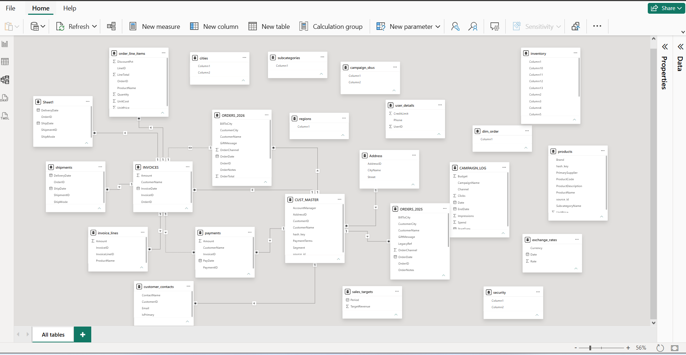
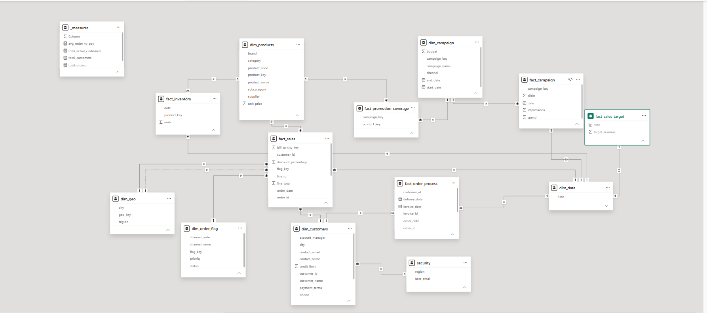

# Power BI Data Modelling Project

## Overview
Rebuilt a real-world nightmare Power BI data model into a 
clean, structured star/galaxy schema. The business is a B2B company selling a 
wide range of products (laptops, skincare, men's, women's and kids' items, 
furniture and more) and shipping to multiple countries. The original dataset 
contained 23 messy tables with mixed fact and dimension data, 
missing keys, duplicate tables, no naming standards, and 
confusing relationships and made accurate reporting  impossible.

## Before — The Nightmare Model

## After — The Clean Model

## The Problem
The original model could not be trusted for reporting:
- Fact and dimension data mixed together in the same tables
- Missing keys, so tables could not be related properly
- Duplicate tables holding overlapping data
- No naming standards, with unnamed columns (Column1, Column2) in several tables
- Confusing relationships that made it unclear how filters would flow
- Different departments pulling inconsistent numbers from the same data

## What I Did

**1. Separated facts from dimensions**
Split the mixed tables into transaction (fact) tables and descriptive 
(dimension) tables, so each table has one clear job.

**2. Fixed keys and relationships**
Added the missing keys and rebuilt the relationships so every fact table 
connects to its dimensions in a clear one-to-many pattern.

**3. Removed duplicates and unnecessary data**
Removed or deactivated unused tables and columns so only what the model 
actually needs is loaded. This also improved performance.

**4. Standardized naming**
Applied consistent conventions: `fact_` and `dim_` prefixes for tables, 
lowercase snake_case for columns, and a clearly named `_measures` table.

**5. Built a shared date dimension**
The original model had no date table. I created `dim_date` using 
`CALENDARAUTO()` and connected it to the fact tables. As the most shared 
dimension in the model, it lets different reports be compared over the 
same time periods.

**6. Implemented dynamic row-level security**
Built a security table and used DAX to apply dynamic RLS, so each user only 
sees the data they are allowed to see, based on region.

**7. Created a dedicated measures table**
Moved the core DAX measures into one table:
- Total Orders
- Total Customers
- Total Active Customers
- Average Order to Pay

## Final Model Structure
| Table Type | Count |
|---|---|
| Fact Tables | 6 |
| Dimension Tables | 6 |
| Security Table | 1 |
| Measures Table | 1 |
| **Total** | **14** |

## Results
- Consistent numbers across departments, because everyone now reports 
  from the same structure
- Time comparisons across reports are now possible through the shared 
  date dimension
- Access to data is controlled per user through dynamic RLS
- Faster, lighter model after removing unused tables and columns

## Key Concepts Applied
Star schema, galaxy schema, Proper fact and dimension table design, 
relationship management, DAX measures, row level security, standards,
naming conventions

## Tools Used
Power BI Desktop
